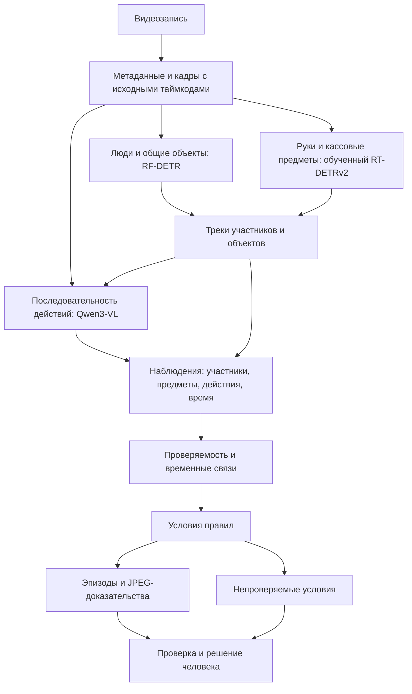
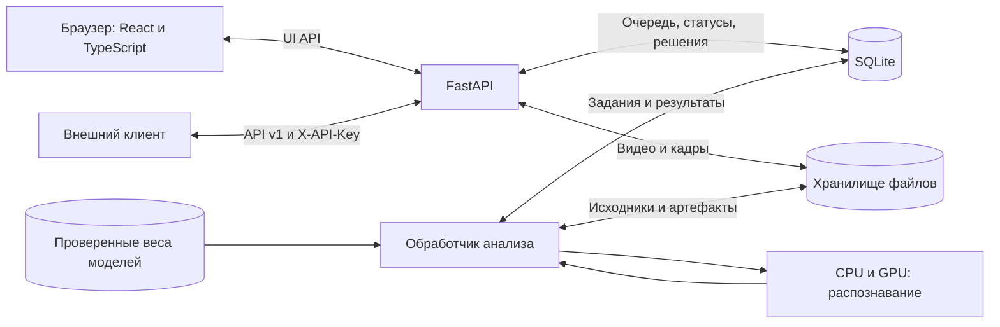
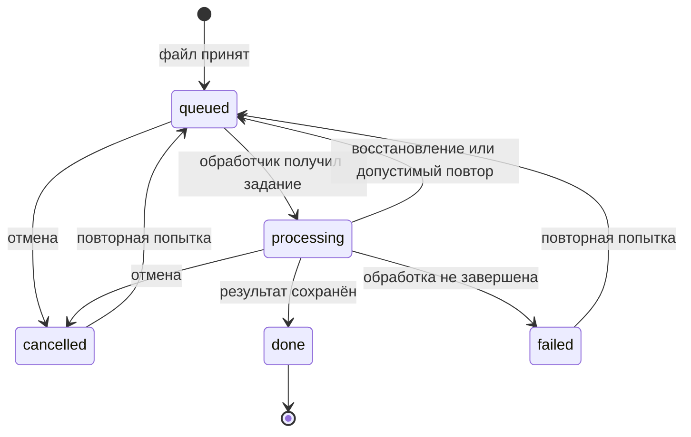

# Lado

**Всё важное — на виду.** Анализ кассовых операций по видеозаписи.

Lado помогает внутреннему контролю разбирать записи кассовых операций: находит
эпизоды, показывает участников и предметы, связывает наблюдаемые действия
с условиями правил и собирает кадры-доказательства. Проверяющий сопоставляет
находку с исходной записью, подтверждает или отклоняет её и сохраняет решение.

**[Открыть приложение](https://darinax2005x--lado-ladoservice-web.us-east.modal.run/app)**
· [Правила](https://darinax2005x--lado-ladoservice-web.us-east.modal.run/app/norms)
· [Презентация · PDF](https://darinax2005x--lado-ladoservice-web.us-east.modal.run/presentation/lado-pitch.pdf)
· [Редактируемая презентация · PPTX](https://darinax2005x--lado-ladoservice-web.us-east.modal.run/presentation/lado-pitch.pptx)
· [GitHub](https://github.com/DarinaX2005X/dreamteam-datathon)
· [Контракты API](contracts/openapi.json)
· [Развёртывание в Modal](deploy/MODAL.md)

Приложение работает в экспериментальном режиме. Автоматическая находка — признак
возможного нарушения для проверки человеком. Отсутствие находок не подтверждает
соблюдение всех требований: действие может быть неразличимо, перекрыто или
пропущено моделью.

## Содержание

- [Возможности](#возможности)
- [Работа с интерфейсом](#работа-с-интерфейсом)
- [Как устроен анализ](#как-устроен-анализ)
- [Архитектура сервиса](#архитектура-сервиса)
- [Модели и подготовка данных](#модели-и-подготовка-данных)
- [Правила и нормативные основания](#правила-и-нормативные-основания)
- [Запуск на GPU-сервере](#запуск-на-gpu-сервере)
- [HTTP API](#http-api)
- [Хранение и доступ](#хранение-и-доступ)
- [Структура репозитория](#структура-репозитория)
- [Разработка и проверки](#разработка-и-проверки)

## Возможности

| Задача | Что предоставляет Lado |
| --- | --- |
| Загрузить запись | Проверка файла, очередь, этапы обработки, отмена и повторная попытка. |
| Проследить действия | Треки людей и объектов, рамки рук, банкнот, удостоверений и счётчиков банкнот. |
| Разобрать эпизод | Таймкод, описание наблюдаемого действия, исходное видео и кадры-доказательства. |
| Проверить основание | Условия правила, ссылка на источник и ограничения применимости. |
| Зафиксировать решение | Подтверждение или отклонение находки, заметка проверяющего. |
| Подготовить результат | Лист проверки для печати или сохранения в PDF через браузер. |
| Подключить другой сервис | Загрузка видео и получение результата через HTTP API. |

Деньги на столе, деньги в руках, передача денег и деньги в счётчике описываются
как разные наблюдения. Детекция предмета не равна распознаванию действия;
распознанное действие само по себе не устанавливает нарушение.

## Работа с интерфейсом

1. Откройте приложение и загрузите видеозапись.
2. Дождитесь обработки: приложение показывает этапы чтения видео, распознавания,
   построения фактов, проверки правил и подготовки доказательств.
3. Выберите эпизод и сопоставьте его таймкод с исходной записью и рамками объектов.
4. Прочитайте условие правила и ограничения вывода. Подтвердите или отклоните
   находку; при необходимости добавьте заметку.
5. Откройте лист проверки и распечатайте его либо сохраните в PDF.

| Адрес | Страница |
| --- | --- |
| `/` | Главная страница проекта. |
| `/app` | Загрузка новой записи. |
| `/app/checks/<id>` | Разбор записи и решения по эпизодам. |
| `/app/checks/<id>/sheet` | Лист проверки. |
| `/app/norms` | Справочник правил и источников. |

## Как устроен анализ



### 1. Чтение записи

FFmpeg/ffprobe проверяет видеодорожку и метаданные. PyAV декодирует кадры
с исходными временными метками и учитывает поворот изображения. Временная
шкала опирается на реальные метки PTS, в том числе у записи с переменной
частотой кадров.

### 2. Объекты и треки

Общий детектор обнаруживает людей и предметы сцены. Отдельный обученный детектор
ищет кисти рук, банкноты, удостоверения и счётчики банкнот. Для мелких предметов
используются полный кадр и перекрывающиеся фрагменты. ByteTrack связывает
обнаружения во времени; исходные оценки детектора сохраняются в данных трека.

### 3. Действия во времени

Qwen3-VL получает последовательность кадров, известные идентификаторы людей
и пространственные подсказки. Дополнительный увеличенный фрагмент помогает
разбирать работу с мелкими предметами. Модель предлагает наблюдения, роли,
связи между действиями с одной пачкой денег и подтверждённые отражения.
Идентификаторы, интервалы и ссылки на объекты проходят программную проверку.

Профиль `v10-questions` дополнительно проверяет оставленную инкассаторскую сумку
четырьмя отдельными вопросами на коротких перекрывающихся отрезках записи:
видна ли сумка на столе, дошёл ли сотрудник до выхода из помещения,
осталась ли та же сумка и остался ли стол без видимого сотрудника рядом.
Событие требует совпадающих последовательных кадров во всех четырёх ответах
и видимой сумки до ухода. Ответ «не видно» не считается подтверждением.

Близость руки к предмету не превращается автоматически в передачу или пересчёт.
Отражение исключается из соответствующих наблюдений только при подтверждённой
связи с физическим источником на конкретном интервале.

### 4. Факты и правила

Конвейер объединяет наблюдения с ролями, зонами и покрытием записи. Правило
проверяет необходимые события и их порядок: кто участвовал, какой объект
наблюдался, что произошло раньше и что оставалось видно одновременно.
Недостаточный обзор отражается в проверяемости правила.

### 5. Доказательства и решение

Для находки сохраняются таймкод начала эпизода, объяснение, ссылки на основания и кадры
из исходной записи. Рамки накладываются отдельно от оригинального изображения.
В описании и листе проверки показывается один момент начала; внутренний интервал
доказательств сохраняет контекст действий до и после него.
Решение проверяющего хранится как отдельная ревизия и не подменяет исходные
автоматические наблюдения.

## Архитектура сервиса



API принимает файл и возвращает идентификатор задания. Обработчик анализирует
запись независимо от открытой страницы. UI и API v1 используют одну очередь;
задания API получают приоритет. Владение заданием ограничено lease: после сбоя
просроченное задание может быть восстановлено, а устаревшая попытка не может
опубликовать результат поверх новой.

В конфигурации Modal один контейнер содержит API и обработчик и единолично
записывает SQLite. Видео, результаты и веса находятся в постоянных томах.
При простое контейнер останавливается; следующий запрос запускает его заново
и требует загрузки моделей. Это влияет на время первого ответа.

### Жизненный цикл задания



API v1 объединяет состояния очереди и активной обработки в `processing`.
Технический сбой возвращается как `failed`, без успешного вердикта.

## Модели и подготовка данных

| Компонент | Назначение |
| --- | --- |
| RF-DETR Nano, ONNX | Люди и общие объекты; UINT8-вариант для CPU или FP32-вариант для CUDA. |
| RT-DETRv2-r18 | Обученные рамки рук, банкнот и счётчика; отдельная модель удостоверений в составе общего профиля. |
| Qwen3-VL-8B-Instruct | Анализ последовательности кадров, действий и связей между ними. |
| ByteTrack | Связывание обнаруженных объектов и людей во времени. |

Профиль предметного детектора называется `lado-objects-v7-composite`. Основная
модель определяет руки, деньги и счётчик; модель удостоверений проверяет
фрагменты около обнаруженных объектов. Для обучения размечен датасет с рамками
целевых классов. Неоднозначные кадры исключаются из соответствующего рецепта
обучения. Разбиение выполняется по исходным видео, чтобы соседние кадры одной
записи не попадали одновременно в обучение и независимую проверку.

Версии, размеры и SHA-256 файлов закреплены в [манифесте моделей](models/manifest.json).
Публичные базовые веса загружаются скриптом; обученные веса проекта поставляются
отдельно. Видео, разметка, рабочие артефакты и веса не входят в Git.

Инструкции по разметке, обучению и экспорту: [training/README.md](training/README.md).
Методика оценки и запуск проверок: [eval/README.md](eval/README.md).

## Правила и нормативные основания

Правила хранятся отдельно от модели:

| Данные | Расположение |
| --- | --- |
| Условия срабатывания, временные отношения, требования к обзору | [rules/catalog/](rules/catalog/) |
| Источники, пункты, формулировки и ограничения применимости | [rules/sources/](rules/sources/) |
| Типизированные контракты правил | [backend/navidu/contracts/](backend/navidu/contracts/) |
| Исполнитель правил | [backend/navidu/rules/](backend/navidu/rules/) |

В нормативном каталоге используются источники по кассовым операциям и инкассации,
включая постановления Национального Банка РК №231 и №14. Настройки проекта
и пользовательские критерии имеют собственное происхождение и не выдаются
за требования этих нормативных актов.

[Сценарий оставленной сумки](rules/catalog/V-BAG-UNATTENDED.yaml) имеет
отдельное основание в разметке кейса и его фактическом уточнении. Результат
содержит это происхождение и ограничения: содержимое закрытой сумки,
внутренний порядок хранения и передача ответственности за кадром не установлены.

Например, [правило об уходе кассира](rules/catalog/V-LEFT-POST.yaml) проверяет
цепочку обслуживания конкретного клиента, уход кассира с поста и присутствие
того же клиента. Исчезновение рамки человека само по себе не доказывает уход,
а отсутствие клиента в кадре не определяет тип кассовой операции.

Для правила различаются срабатывание, отсутствие найденного срабатывания
и непроверяемость по доступным наблюдениям. Уверенность детектора предмета
не является вероятностью юридического нарушения.

## Запуск на GPU-сервере

### Окружение

Нужны Linux, Python 3.10+, FFmpeg/ffprobe, Node.js с npm, драйвер NVIDIA
и CUDA-совместимая сборка PyTorch. Опубликованный Modal-профиль использует L4
с 24 ГБ видеопамяти. Требования к памяти зависят от моделей, числа кадров
и размеров входного изображения.

Версии Python-зависимостей указаны в [backend/pyproject.toml](backend/pyproject.toml),
JavaScript-зависимостей — в [package-lock.json](package-lock.json).

Пример ниже использует CUDA и FP32-версию общего детектора. Modal-профиль
сочетает UINT8-детектор на CPU с предметными и временной моделями на GPU;
его конфигурация находится в [deploy/modal_app.py](deploy/modal_app.py).

### Установка и веса

Выполняйте команды из корня репозитория на машине, предназначенной для анализа:

```bash
bash scripts/setup_local.sh --device=cuda --venv=backend/.venv --skip-models

backend/.venv/bin/python scripts/fetch_models.py \
  --model rfdetr-nano-onnx-fp32 --model qwen3-vl-8b

backend/.venv/bin/python scripts/fetch_models.py \
  --model rfdetr-nano-onnx-fp32 --model qwen3-vl-8b --verify-only
```

Скрипт установки создаёт Python-окружение, устанавливает зависимости и собирает
интерфейс. Обученные веса предметного детектора поместите в
`models/lado-objects-v7-composite/`, сохранив вложенную структуру из экспорта:

```bash
backend/.venv/bin/python scripts/fetch_models.py \
  --model lado-objects-v7-composite --verify-only
```

### Конфигурация

Создайте `.env` в корне проекта. Укажите собственный длинный случайный API-ключ:

```dotenv
NAVIDU_ENV=production
NAVIDU_API_KEYS=<ваш API-ключ>
NAVIDU_HOST=127.0.0.1
NAVIDU_PORT=8000
NAVIDU_DEVICE=cuda
NAVIDU_DETECTOR_MODEL=rfdetr-nano-onnx-fp32
NAVIDU_SEMANTIC_MODEL=qwen3-vl-8b
NAVIDU_OBJECT_MODEL=lado-objects-v7-composite
NAVIDU_REQUIRE_SEMANTIC=true
NAVIDU_EXPERIMENTAL_ANALYSIS=1
NAVIDU_ALLOW_EXPERIMENTAL_API=1
NAVIDU_ANALYSIS_FPS=3
NAVIDU_SEMANTIC_DTYPE=bf16
NAVIDU_QWEN_INPUT_MODE=video
NAVIDU_SEMANTIC_WINDOW_FRAMES=32
NAVIDU_SEMANTIC_FPS=1
NAVIDU_SEMANTIC_MAX_NEW_TOKENS=1536
NAVIDU_SEMANTIC_PROMPT_VARIANT=v10-questions
NAVIDU_QWEN_MAX_PIXELS=262144
NAVIDU_QWEN_DETAIL_VIEW=1
NAVIDU_CPU_THREADS=2
HF_HUB_OFFLINE=1
TRANSFORMERS_OFFLINE=1
HF_HUB_DISABLE_TELEMETRY=1
```

Экспериментальный режим разрешает работу текущей модели без принятого профиля
качества. API обозначает его заголовком `X-Analysis-Mode: experimental`.
Отключение этих флагов само по себе не подтверждает качество: для проверенного
режима требуется подходящий профиль валидации.

| Параметр | Назначение и значение по умолчанию |
| --- | --- |
| `NAVIDU_MAX_UPLOAD_MB` | Максимальный файл: 300 МиБ. |
| `NAVIDU_MAX_DURATION_SEC` | Максимальная длительность записи: 600 секунд. |
| `NAVIDU_QUEUE_MAX` | Максимальное число активных заданий: 20. |
| `NAVIDU_UI_MAX_ACTIVE_PER_IP` | Активные загрузки UI с одного IP: 2. |
| `NAVIDU_RETAIN_VIDEO_HOURS` | Хранение исходной записи после завершения: 24 часа. |
| `NAVIDU_RETAIN_RESULTS_DAYS` | Хранение результата: 7 дней. |
| `NAVIDU_EVIDENCE_OVERLAY` | Рамки в API-кадрах: `true`. |
| `NAVIDU_DATA_DIR` | Каталог базы, записей и результатов. |
| `NAVIDU_MODELS_DIR` | Каталог весов и манифеста моделей. |
| `NAVIDU_RULES_DIR` | Каталог правил и источников. |
| `NAVIDU_WEB_DIST` | Каталог собранного интерфейса. |

При запуске скриптом пути к данным, моделям и интерфейсу по умолчанию указывают
на каталоги проекта. Для переопределения путей используйте абсолютные значения.
[.env.example](.env.example) содержит также контейнерные пути и базовые настройки;
не переносите их в другое окружение без адаптации.

### Запуск и готовность

```bash
backend/.venv/bin/python scripts/run_local.py
```

Приложение доступно на `http://127.0.0.1:8000/app`. Скрипт запускает API
и обработчик; `Ctrl+C` останавливает принадлежащие ему процессы. Журналы
сохраняются в `logs/api.log` и `logs/worker.log`.

Проверьте готовность перед отправкой записи:

```bash
curl --fail http://127.0.0.1:8000/api/ui/health
```

Нужны `ready: true`, `analysis_ready: true` и `model_status: "ready"`.
Доступность HTTP ещё не означает, что модели загрузились.

Для разработки интерфейса при работающем backend:

```bash
npm run dev
```

Размещение в Modal описано в [deploy/MODAL.md](deploy/MODAL.md).
Другие способы запуска и контейнерная конфигурация — в
[deploy/README.md](deploy/README.md).

## HTTP API

Базовый адрес опубликованного сервиса:
`https://darinax2005x--lado-ladoservice-web.us-east.modal.run`.

Все маршруты `/api/v1` требуют заголовок `X-API-Key`. Ключ передаётся оператором
развёртывания и не хранится в репозитории. Далее `LADO_BASE_URL` и `LADO_API_KEY`
обозначают переменные окружения клиента.

### Отправка видео

```bash
curl --fail "$LADO_BASE_URL/api/v1/analyze" \
  -H "X-API-Key: $LADO_API_KEY" \
  -F "file=@/path/to/video.mov"
```

Сервис проверяет реальную видеодорожку через ffprobe. Поддержка конкретного
контейнера и кодека зависит от установленной сборки FFmpeg; расширения файла
недостаточно для признания его корректной записью.

Ответ на принятую загрузку:

```json
{"job_id":"012345abcdef","status":"processing"}
```

### Получение результата

```bash
curl --fail "$LADO_BASE_URL/api/v1/jobs/012345abcdef" \
  -H "X-API-Key: $LADO_API_KEY"
```

Пока задание выполняется, возвращается `processing`. Пример завершённого
ответа без найденных эпизодов:

```json
{
  "job_id": "012345abcdef",
  "status": "done",
  "verdict": "no_violation",
  "violations": []
}
```

При наличии эпизодов `verdict` равен `violation`, а каждый элемент `violations`
содержит:

| Поле | Содержимое |
| --- | --- |
| `type` | Тип находки. |
| `timecode_sec` | Время эпизода в секундах от начала записи. |
| `description` | Описание наблюдаемого действия и основания проверки. |
| `evidence_frames` | От одного до трёх кадров, каждый с `timestamp_sec` и `image_base64`. |

`image_base64` содержит JPEG без префикса `data:`. Таймкод находки совпадает
с временем её первого кадра-доказательства. Эпизоды упорядочены по времени.
При сбое возвращаются `status: "failed"` и `error`, без успешного вердикта.

### Основные ошибки

| HTTP | Код | Что проверить |
| --- | --- | --- |
| 400 | `MISSING_FILE` | Передано ли непустое поле `file`. |
| 401 | `UNAUTHORIZED` | Наличие и значение API-ключа. |
| 413 | `FILE_TOO_LARGE` | Размер файла и лимит загрузки. |
| 415 | `UNSUPPORTED_MEDIA` | Читаемость видеодорожки и поддержка кодека. |
| 422 | `VIDEO_TOO_LONG` | Длительность записи и настроенный лимит. |
| 503 | `NOT_READY` | Состояние обработчика, доступность весов и загрузку моделей. |

Точная схема API: [contracts/openapi.json](contracts/openapi.json).
JSON Schema отдельных объектов: [contracts/schemas/](contracts/schemas/).
Расширенные маршруты `/api/ui` обслуживают интерфейс, решения проверяющего,
кадры и повторную оценку правил.

## Хранение и доступ

```text
data/
├── navidu.sqlite3              очередь, статусы, ревизии и решения
└── checks/<check_id>/          видео, промежуточные данные и кадры

models/
├── manifest.json              версии, размеры и SHA-256
├── qwen3-vl-8b/                временная модель
└── lado-objects-v7-composite/  обученные предметные модели

logs/
├── api.log
└── worker.log
```

Модели выполняются в окружении сервиса; внешние AI API для анализа записей
не требуются. Работа с идентификаторами треков не является распознаванием лиц.
Сервис не предназначен для установления личности, чтения реквизитов документов,
определения точных сумм или проверки бухгалтерского учёта по общему плану камеры.

API-ключ защищает `/api/v1`. Интерфейс и его маршруты `/api/ui` требуют внешнего
контроля доступа, если развёртывание должно быть закрытым. SQLite, модельные
каталоги, исходные записи и секреты не следует публиковать как статические файлы.

## Структура репозитория

| Каталог | Назначение |
| --- | --- |
| `backend/navidu/ingest/` | Проверка записи, декодирование и исходные таймкоды. |
| `backend/navidu/perception/` | Детекторы, временная модель, трекинг и отражения. |
| `backend/navidu/scene/`, `backend/navidu/facts/` | Роли, зоны, наблюдения и проверяемость. |
| `backend/navidu/rules/`, `backend/navidu/evidence/` | Применение правил и подготовка доказательств. |
| `backend/navidu/service/` | FastAPI, очередь, хранение, обработчик и ревизии. |
| `web/` | Интерфейс разбора записи на React и TypeScript. |
| `landing/` | Главная страница как отдельный пакет. |
| `contracts/` | OpenAPI, JSON Schema и TypeScript-типы. |
| `rules/` | Условия проверок, источники и параметры. |
| `models/` | Манифест моделей; веса поставляются отдельно. |
| `training/`, `eval/` | Подготовка данных, обучение и оценка. |
| `scripts/`, `deploy/` | Установка, запуск и развёртывание. |
| `identity/` | Исходники айдентики. |

Публичное название — **Lado**. Внутренний Python namespace `navidu` и переменные
`NAVIDU_*` сохранены для совместимости пакета и конфигурации.

## Разработка и проверки

После установки backend активируйте его окружение, прежде чем запускать проверки:

```bash
source backend/.venv/bin/activate
python -m pip install -e 'backend[dev]'
python -m ruff check --config backend/pyproject.toml backend/navidu backend/tests
python -m pytest backend/tests training/tests deploy/tests -q
npm test
npm run typecheck
npm run build
```

Python-модели в `backend/navidu/contracts/` служат источником общих контрактов.
После изменения схем обновите сгенерированные файлы:

```bash
python -m navidu.contracts.generate
```

Код проверяется статическими, модульными, доменными и HTTP/API-проверками.
Внешний вид, воспроизведение видео и поведение интерфейса проверяет пользователь;
автоматизация браузера для проверки проекта не используется.

Для проверки настоящего API на выбранных записях предназначен
[scripts/smoke_api.py](scripts/smoke_api.py). Он проверяет состояния задания,
схему ответа, таймкоды и формат JPEG. Успешное выполнение API-проверки
не заменяет оценку точности обнаружения нарушений.
