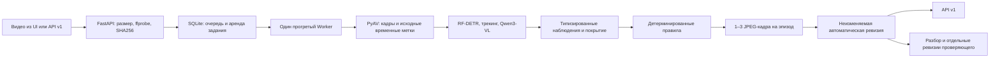

# Lado

**Всё важное — на виду.** Проверка кассовых операций по видеозаписи.

Lado помогает сотруднику внутреннего контроля разобрать запись: найти эпизод,
перейти к его таймкоду, посмотреть исходные кадры, сопоставить наблюдаемое действие
с конкретным условием правила и сохранить собственное решение. Автоматический
эпизод означает признак возможного нарушения. Применимость нормы и окончательную
оценку проверяет человек.

## Текущее состояние

Состояние на 18 октября 2026 года:

| Часть | Что есть и что ещё не подтверждено |
| --- | --- |
| Приложение и API | Реализованы загрузка, очередь, прогресс, разбор эпизодов, рамки объектов, решения и заметки, печатный лист, API v1 и хранение ревизий. |
| Конвейер | Реальные декодирование, детектор, трекер, временная модель, правила и JPEG-доказательства. Диагностический результат не публикуется как завершённая пользовательская проверка. |
| Текущая модель для измерений | Qwen3-VL-4B-Instruct bf16, native video до 64 кадров при 1 fps, prompt v8-focused. После исключения противоречивых заявлений о людях/отражениях на восьми development-validation видео: TP1/TN4/FP0/FN3. Единственная находка — по пользовательскому правилу о числе людей. Денежные действия и рамки предметов на этом прогоне не извлечены. Qwen8B на контрольной паре выигрыша не дала и не подключена. Принятого профиля качества нет. |
| Готовность сервиса | По умолчанию нужен принятый профиль качества. `NAVIDU_EXPERIMENTAL_ANALYSIS=1` разрешает работу исходной модели в UI. Дополнительный `NAVIDU_ALLOW_EXPERIMENTAL_API=1` разрешает её реальные результаты через API v1 с заголовком `X-Analysis-Mode: experimental`. Эти настройки не подтверждают качество модели. |
| Обучение | Qwen LoRA обучена на 24 train-видео и проверена на восьми validation: после эпохи все восемь предсказаний положительные, balanced accuracy 0,50. Улучшения нет, checkpoint не выбран. InternVL остановлен по запросу пользователя после двух неулучшивших эпох. Веса сохранены приватно; ни один адаптер не включён на сайте. |
| Развёртывание | Brev остановлен. Пользователь разрешил 32 development-видео в Modal и L4. [Сайт](https://darinax2005x--lado-ladoservice-web.us-east.modal.run/app) и API доступны; проверены HTTP readiness, ключ жюри и полный запрос. Ключ хранится приватно. UI проверяет пользователь. Конфигурация — в [deploy/MODAL.md](deploy/MODAL.md). |

Историческая проверка 1B на двух development-записях дала TP=0, TN=1, FN=1.
Это диагностический результат небольшой пробы, а не показатель принятого качества.
Успешные unit-тесты, загрузка весов или пустой ответ модели не заменяют оценку на
положительных и отрицательных записях.
Ранее полный HTTP-прогон InternVL4B технически завершил все восемь inner-validation видео,
но пропустил все четыре положительных. Увеличение числа image patches не улучшило
решения; prompt v5 устранил ошибки индексов кадров, но итоговые пропуски сохранились.
Числа и синтетическая проверка вставки visual embeddings:
[l40s-pipeline-4b-local-frames.json](eval/reports/l40s-pipeline-4b-local-frames.json).
Исходная InternVL8B с теми же настройками также пропустила все четыре положительных
видео и добавила одно ложное срабатывание; её веса сохранены, но замена отклонена:
[l40s-pipeline-8b-local-frames.json](eval/reports/l40s-pipeline-8b-local-frames.json).
Метрики proposal-модуля и нормативного конвейера учитываются отдельно:
улучшение одного ещё не доказывает улучшение другого. Отложенные восемь видео
не используются для выбора модели или параметров.

Последние числовые отчёты: [Qwen и длинный видеоконтекст](eval/reports/modal-context-comparison.json)
и [обучение Qwen](eval/reports/modal-qwen-proposal-l4.json). Development-набор уже
использовался при разработке многократно; эти результаты не являются независимой
финальной оценкой. Успешные проверки кода не подтверждают качество распознавания.

## Рабочий сценарий

1. Откройте `/app` и загрузите разрешённую запись. Интерфейс показывает очередь,
   этап обработки и фактически обработанное время. Достижение последней секунды
   видео не завершает проверку до выполнения правил и подготовки доказательств.
2. На странице проверки выберите эпизод на временной шкале. Сопоставьте видео,
   исходный кадр и кадр с наложением объектов. У эпизода есть объяснение видимого
   признака, основание правила и границы вывода.
3. Включите рамки объектов при просмотре записи и сопоставьте находку с кадрами.
   Рамки не перехватывают управление видеоплеером. Редактор зон и вопросы о ролях
   убраны из интерфейса по результатам пользовательской проверки.
4. Подтвердите эпизод, отклоните его или отметьте, что действие не видно. Заметку
   можно сохранить до принятия решения. Конфликт параллельных изменений возвращает
   текущую ревизию вместо молчаливого перезаписывания.
5. Откройте лист проверки `/app/checks/<id>/sheet` и используйте печать или сохранение
   в PDF средствами браузера. В листе указаны ревизия, решения, доказательства и нормы.

Справочник `/app/norms` показывает источники и условия правил. Собственный пример
добавляется отдельной [командой](examples/README.md); готового демонстрационного
видео в репозитории нет. Материалы организаторов не используются как публичный пример.

## Какие условия проверяются

Каталог привязан к отдельным положениям Правил осуществления кассовых операций и
операций по инкассации, утверждённых постановлением Правления Национального Банка
Республики Казахстан №231 от 29 ноября 2019 года. Локальные записи источников
содержат редакцию, дату проверки, точную цитату и официальный URL:
[S231](rules/sources/S231.yaml), [сопоставление видимых признаков](research/norms/mapping-review.md).
Верификация цитаты не подтверждает, что условия этого пункта различимы в конкретном видео.

| Правило | Наблюдаемая последовательность | Основание и состояние каталога |
| --- | --- | --- |
| `V-COUNT-ABSENT` | Передача конкретной суммы от клиента кассиру, видимый уход этого клиента и последующий пересчёт той же суммы | Пункт 20; включено при наличии нужных возможностей модели и покрытия. |
| `V-LEFT-POST` | Начавшееся обслуживание продолжается, клиент остаётся, кассир действительно выходит из рабочей зоны | Пункт 22; потерянный трек сам по себе не считается уходом. |
| `V-CASH-UNSECURED` | Деньги прослежены от предыдущего приёма и остаются на открытой поверхности при следующем клиенте | Пункт 20, хранение ранее принятых наличных; одного кадра с деньгами недостаточно. |
| `V-BAG-OPENED-ALONE` | Вскрытие и пересчёт заранее повреждённой той же инкассаторской сумки при установленном отсутствии инкассатора в полностью видимой области | Пункт 25; к любой целой сумке условие не переносится. В текущем runtime `continuous_collector_visibility=false`, поэтому правило остаётся непроверяемым. |
| `V-PERSONAL-ITEMS` | Различим предмет с признаком личного средства связи или камеры у кассира | Пункт 12 с исключениями; принадлежность, назначение и наличие функции камеры требуют проверки человеком. |
| `V-COUNT-NO-CONTROLLER` | Внутренняя операция пересчёта, сортировки или упаковки при установленном контексте | Пункт 42; **выключено** до появления измеренного источника нужного контекста и видимости. |
| `V-OUTSIDER` | Видимый вход в установленную кладовую или сейфовую комнату | Пункт 75; **выключено**: полномочия и документальное основание доступа недоступны из изображения. |
| `V-EXTRA-PERSON` | Как минимум три ясно видимых физических человека в одних и тех же последовательных кадрах | Отдельный критерий пользователя, не законодательная норма. Смена клиентов и подтверждённые отражения не увеличивают число одновременных участников. |

Включённое правило не обязательно проверяемо на каждой записи. Движок учитывает
непрерывность наблюдения, видимость области, роли, связь событий одной операции и
подтверждённые возможности модели. Недостаток данных отображается как ограничение
проверки. Если не найдено эпизодов и все включённые правила непроверяемы, пользователь
получает `ANALYSIS_INCOMPLETE`, а не отрицательный вердикт.

Lado не определяет сумму, подлинность документов, банковские полномочия, действия
за пределами обзора и содержание неразличимых предметов. Список невизуальных
условий хранится отдельно в [каталоге источников](rules/sources/not-visual.yaml).

Каталог не исчерпывает задачу: FAQ допускает незнакомые типы в тесте.
В [исследовании таксономии](research/norms/expanded-taxonomy.md) разобраны ещё пять
условных типов и границы применимости норм. Они пока не включены в автоматический
каталог; для этого нужна явная разметка и отдельная проверка качества.

## Как устроен анализ



- **Восприятие.** RF-DETR Nano в ONNX Runtime выделяет объекты; трекер связывает их
  во времени. Qwen3-VL анализирует упорядоченные окна кадров; адаптер InternVL сохранён
  для воспроизводимости прежних сравнений. Ответ модели проверяется
  до преобразования в наблюдения; таймкоды связаны с реальными исходными кадрами.
- **Факты и правила.** Геометрия, роли, временные связи и сведения о покрытии отделены
  от нормативных условий. Правила описаны в `rules/catalog/`, параметры — в
  `rules/calibration/`. Новое имя модели или успешный импорт не включают возможность автоматически.
- **Доказательства.** Для находки сохраняются реальные JPEG из видео и вариант с
  наложением. Таймкод эпизода совпадает со временем первого кадра-доказательства.
- **Хранение.** SQLite ведёт очередь, аренды, попытки, события и ревизии. Файлы лежат
  в `data/checks/<id>/`. Сбой обработчика восстанавливается по истечении аренды;
  устаревший обработчик не может опубликовать результат.
- **Повторное использование.** Кеш связан с SHA256 видео и эффективной версией
  конвейера, учитывающей код, веса, параметры, правила и устройства. В новую проверку
  переносятся автоматические артефакты, без решений и заметок другого разбора.
- **Ручной разбор.** Решения и заметки проверяющего сохраняются отдельно от
  автоматических наблюдений; сохранение проходит проверку ревизии. API v1 всегда
  возвращает автоматическую ревизию, даже после решений проверяющего в интерфейсе.

### Что даёт LoRA и чего она не устанавливает

Подготовленный обучающий модуль учит InternVL3.5-4B предлагать наличие эпизода и его
время по бинарным меткам и таймкодам организаторов. Это задача поиска кандидата для
более подробной проверки. Предложение не является нормативным фактом и не может
само назначить тип нарушения, роль человека или пункт правил.

Разбиение сгруппировано по уникальному SHA256: 24 источника для обучения, 8 для
выбора параметров и 8 зарезервированных для итоговой оценки. Копии одной записи не
попадают в разные части. При спорном таймкоде бинарная цель сохраняется, временная
потеря маскируется. Во время оценки окна выбираются без знания целевых таймкодов.

В [коде обучения](training/train_proposal.py) предусмотрены до трёх эпох, LoRA rank 8,
alpha 16, dropout 0.05, выбор по внутренней validation и сохранение
`adapter_model.safetensors`, `adapter_config.json`, `run-manifest.json` и
`progress.json`/`progress.jsonl`. Код требует разрешённый Linux-хост с L40S и не
запускает обучение на рабочем ноутбуке. Первый [пилот](eval/reports/l40s-proposal-pilot.json)
завершён, но адаптер не прошёл отбор. Протокол данных, оценки и итогового holdout описан в
[eval/README.md](eval/README.md).

По умолчанию запуск ограничен 165 минутами (`--max-wall-minutes`), с резервом
для записи checkpoint. После каждой эпохи нужен выигрыш на тех же validation-видео
без потери ранее правильного ответа; при одинаковых ответах сравнивается ошибка
таймкода на тех же положительных источниках (среднее улучшение не меньше 0,5 с).
Неудачный запуск сохраняет веса,
но оставляет `selected_epoch=null`. До следующей эпохи проверяется измеренный бюджет.
Проверочный loss отдельно не вычисляется: выбор основан на реальных ответах модели.
Исследование внешних данных и альтернативного временного классификатора —
[datasets-and-budget.md](research/training/datasets-and-budget.md).

## Требования

Нужны Python **3.10 или новее**, FFmpeg и ffprobe в `PATH`, Node.js с npm для сборки
интерфейса. Для текущего GPU-профиля нужны совместимый драйвер NVIDIA и CUDA-сборка
PyTorch. Скрипты установки создают отдельное Python-окружение и используют
зафиксированные версии из [backend/pyproject.toml](backend/pyproject.toml).

| Компонент | Версия в проекте |
| --- | --- |
| Python-контракты | Pydantic 2.14.1 |
| Inference | PyTorch 2.6.0, torchvision 0.21.0, Transformers 4.57.6 |
| ONNX | onnxruntime или onnxruntime-gpu 1.23.2 |
| Видео и изображения | PyAV 13.1.0, NumPy 1.26.4, Pillow 12.3.0 |
| Трекинг | supervision 0.29.1 |
| Загрузка весов | safetensors 0.5.3, tokenizers 0.22.2, huggingface-hub 0.36.2 |
| Опциональные адаптеры | PEFT 0.17.1, Accelerate 1.10.1, extra `adapters` |
| UI | React 18, TypeScript, Vite; точные зависимости устанавливаются через `npm ci` |

Фактически выделенная машина для предстоящих удалённых измерений: NVIDIA L40S,
46 068 MiB видеопамяти по `nvidia-smi`, 8 vCPU, около 144 GiB RAM; постоянный каталог
проекта `/data/dreamteam` находится на разделе около 251 GiB. Это сведения об
аппаратуре, а не подтверждение скорости или точности. CPU-профиль полезен для
разработки и диагностики, но не заменяет измерение целевого GPU-профиля.

## Установка и запуск

Команды ниже выполняются из корня репозитория. Они требуют доступа к интернету
**при установке пакетов и загрузке публичных весов**. Видео и кадры не передаются
в модельные API. После подготовки модели загружаются из локальных файлов.

### Подготовка Linux-хоста с NVIDIA GPU

```bash
bash scripts/setup_local.sh --device=cuda --venv=backend/.venv --skip-models
backend/.venv/bin/python scripts/fetch_models.py --model rfdetr-nano-onnx --model internvl3_5-4b
backend/.venv/bin/python scripts/fetch_models.py --model rfdetr-nano-onnx --model internvl3_5-4b --verify-only
```

`--skip-models` здесь откладывает проверку весов до явной загрузки выбранных моделей.
Скрипт установки собирает UI, но не запускает сервис. Стандартные профили
`fetch_models.py --profile cpu|cuda` пока выбирают **1B**; для 4B нужны явные
`--model`, как в командах выше. Каждый файл проверяется по размеру и SHA256 из
[models/manifest.json](models/manifest.json); неполная загрузка не становится готовыми весами.

Создайте приватный `.env` с новым ключом. Для генерации ключа:

```bash
backend/.venv/bin/python -c "import secrets; print(secrets.token_urlsafe(32))"
```

Минимальная конфигурация нативного запуска текущего профиля:

```dotenv
NAVIDU_ENV=production
NAVIDU_API_KEYS=<сгенерированный ключ>
NAVIDU_HOST=127.0.0.1
NAVIDU_PORT=8000
NAVIDU_DEVICE=auto
NAVIDU_DETECTOR_MODEL=rfdetr-nano-onnx
NAVIDU_SEMANTIC_MODEL=internvl3_5-4b
NAVIDU_SEMANTIC_DTYPE=bf16
NAVIDU_REQUIRE_SEMANTIC=true
NAVIDU_SEMANTIC_MAX_PATCHES=4
NAVIDU_SEMANTIC_MAX_NEW_TOKENS=1024
NAVIDU_SEMANTIC_WINDOW_FRAMES=16
NAVIDU_SEMANTIC_FPS=1
NAVIDU_SEMANTIC_STRUCTURED_OUTPUT=0
NAVIDU_DETECTION_THRESHOLD=0.45
NAVIDU_CPU_THREADS=6
HF_HUB_OFFLINE=1
TRANSFORMERS_OFFLINE=1
HF_HUB_DISABLE_TELEMETRY=1
```

Опциональный `NAVIDU_SEMANTIC_STRUCTURED_OUTPUT=1` требует установки
`backend[structured]` (`lm-format-enforcer==0.11.3`). Он ограничивает JSON и
допустимые индексы/ID участников; проверка реальных фактов остаётся обязательной.
Этот режим пока не оценён на банковских видео и по умолчанию выключен. В окнах
без распознанных участников сохраняется обычное декодирование: текущая версия
библиотеки не обеспечивает ограничение массива до нуля элементов.

Для нативного запуска оставьте `NAVIDU_DATA_DIR`, `NAVIDU_MODELS_DIR`,
`NAVIDU_RULES_DIR` и `NAVIDU_WEB_DIST` незаданными: будут использованы каталоги
проекта. Пути `/app/...` из [.env.example](.env.example) предназначены для контейнера.
Если нужны свои каталоги, задайте абсолютные пути, одинаковые для API и worker.

Загрузите собственный `.env` в текущую Bash-сессию для preflight и запустите приложение:

```bash
set -a
source .env
set +a
backend/.venv/bin/python scripts/preflight.py --device auto --require-models
backend/.venv/bin/python scripts/run_local.py
```

`run_local.py` также читает `.env`, сохраняя приоритет уже экспортированных значений.
Он запускает API и один worker, пишет их журналы в `logs/` и останавливает собственные
дочерние процессы по Ctrl+C. Откройте адрес `/app` самостоятельно после запуска.

Preflight проверяет зависимости, файлы и ресурсы. Сообщение `API bound` проверяет
доступность HTTP. Ни одно из них не подтверждает качество анализа. Проверяйте:

```bash
curl --fail --silent http://127.0.0.1:8000/api/ui/health
```

Перед приёмом видео ответ должен содержать `ready: true`, `analysis_ready: true`,
`analysis_mode: "validated"`, `model_status: "ready"`. Принятый профиль связывается
с измерениями, их контрольными суммами и точной конфигурацией. Пока такого профиля
нет, загрузка отвечает HTTP 503 `NOT_READY`. Не заменяйте измерения ручным выставлением
флага готовности; [оценщик](eval/README.md) не принимает результат автоматически.

### Windows: разработка и API без модели

```powershell
.\scripts\setup_local.ps1 -Python "py -3.10" -Device cpu -VenvPath backend/.venv -SkipModels
.\backend\.venv\Scripts\python.exe scripts/run_local.py --no-worker
```

Это режим для интерфейса и HTTP-интеграции: `ready=false`, загрузка видео недоступна.
Для GPU-окружения установщик поддерживает `-Device cuda`. Все новые тяжёлые измерения
и обучение текущего проекта выполняются на разрешённом удалённом сервере.

### Контейнеры и удалённый сервер

Конфигурация Compose разделяет API и worker; GPU назначается только worker,
SQLite и артефакты доступны им через общий каталог данных. Сеть Compose объявлена
`internal: true`. Настройка GPU и экспорт данных описаны в
[deploy/README.md](deploy/README.md).

Текущий GPU overlay явно выбирает FP32-детектор на CUDA. Он не является тем же
профилем, что описанный выше UINT8-детектор на CPU и 4B на GPU. Проверка качества и
версии должна соответствовать фактически выбранной конфигурации.

Окончательная команда запуска приложения на выделенном `/data/dreamteam` и внешний
адрес будут добавлены после проверенного развёртывания. Приведённые в deploy-документации
шаблоны для других провайдеров не подтверждают, что такой сервер уже запущен.

## API v1

Внешний API использует `X-API-Key` на каждом запросе. `NAVIDU_API_KEYS` может содержать
несколько ключей через запятую. Ключ проверяется до чтения загружаемого файла.

```bash
export LADO_BASE_URL=http://127.0.0.1:8000
export LADO_API_KEY='<один ключ из NAVIDU_API_KEYS>'

curl --fail --silent "$LADO_BASE_URL/api/v1/analyze" \
  -H "X-API-Key: $LADO_API_KEY" \
  -F 'file=@/absolute/path/own-recording.mov'
```

Ответ на принятую загрузку имеет HTTP 200 и форму:

```json
{"job_id":"012345abcdef","status":"processing"}
```

Этот статус включает ожидание в очереди. Опрос:

```bash
curl --fail --silent "$LADO_BASE_URL/api/v1/jobs/012345abcdef" \
  -H "X-API-Key: $LADO_API_KEY" > result.json
```

Конечный успешный ответ содержит только `job_id`, `status`, `verdict`, `violations`.
`verdict` равен `violation` при непустом списке эпизодов и `no_violation` при пустом.
Форма ответа без найденных эпизодов, приведённая как иллюстрация контракта:

```json
{"job_id":"012345abcdef","status":"done","verdict":"no_violation","violations":[]}
```

Каждый элемент `violations` содержит:

| Поле | Значение |
| --- | --- |
| `type` | Читаемое название наблюдаемого признака. |
| `timecode_sec` | Неотрицательное время в секундах от начала записи. |
| `description` | Объяснение эпизода. |
| `evidence_frames` | От 1 до 3 объектов с `timestamp_sec` и `image_base64`. |

`image_base64` — байты JPEG в base64, без префикса `data:`. Эпизоды отсортированы
по времени; `timecode_sec` совпадает со временем первого кадра. Сохранить все кадры
из полученного `result.json` можно обычным Python:

```python
import base64
import json
from pathlib import Path

result = json.loads(Path("result.json").read_text(encoding="utf-8"))
for episode_index, episode in enumerate(result.get("violations", []), 1):
    for frame_index, frame in enumerate(episode["evidence_frames"], 1):
        Path(f"episode-{episode_index}-frame-{frame_index}.jpg").write_bytes(
            base64.b64decode(frame["image_base64"], validate=True)
        )
```

Ошибка обработки возвращается в опросе как `status: "failed"` и объект
`error: {"code": "...", "message": "..."}` без вердикта. Ошибка не превращается
в `no_violation`. Точные Python-модели и сгенерированные схемы находятся в
[backend/navidu/contracts](backend/navidu/contracts/) и [contracts](contracts/).

Для проверки реального API после готовности модели:

```bash
backend/.venv/bin/python scripts/smoke_api.py --base "$LADO_BASE_URL" --key "$LADO_API_KEY" \
  --files /absolute/path/own-recording.mov --parallel 1 --timeout 300
```

Скрипт проверяет схему, временные метки и JPEG-доказательства. Пять параллельных
записей задаются пятью путями и `--parallel 5`; прохождение этого сценария на целевом
сервере ещё должно быть измерено.

## Настройки, хранение и отказы

| Настройка | Значение по умолчанию / смысл |
| --- | --- |
| `NAVIDU_MAX_UPLOAD_MB` | 300 MiB на файл; фактический поток также ограничивается. |
| `NAVIDU_MAX_DURATION_SEC` | 600 секунд. |
| `NAVIDU_QUEUE_MAX` | 20 активных заданий суммарно. Задания API имеют приоритет перед UI. |
| `NAVIDU_UI_MAX_ACTIVE_PER_IP` | 2 активные UI-проверки с адреса; в БД сохраняется хеш с локальной солью. |
| `NAVIDU_ANALYSIS_FPS` | 3 кадра/с для основного прохода. |
| `NAVIDU_RETAIN_VIDEO_HOURS` | 24 часа после завершения; удаляется исходная запись. |
| `NAVIDU_RETAIN_RESULTS_DAYS` | 7 дней после завершения; затем удаляются результаты и доказательства. |
| `NAVIDU_EVIDENCE_OVERLAY` | `true`; определяет выдачу наложений в API v1. |
| `NAVIDU_EXAMPLE_CHECK_ID` | Пусто; кнопка примера скрыта без готового проверенного примера. |

После удаления исходного видео доказательства и решения доступны до удаления
результата. Просмотр видео, повтор и пересчёт, которым нужен исходник, возвращают
`VIDEO_EXPIRED`. Примеры исключены из обычной очистки и доступны только для чтения;
изменения ролей и зон в них можно предпросмотреть без сохранения.

| Состояние | Поведение |
| --- | --- |
| HTTP 401 `UNAUTHORIZED` | Нет подходящего API-ключа. |
| HTTP 413 / 415 / 422 | Превышен размер, нет пригодной видеодорожки или превышена длительность / неверны поля. |
| HTTP 429 `QUEUE_FULL` | Очередь заполнена; ответ содержит `Retry-After`. |
| HTTP 503 `NOT_READY` | Обработчик, веса или подтверждённый профиль анализа не готовы. |
| `ANALYSIS_NOT_PERFORMED` | Полный подтверждённый анализ действий не был выполнен; бинарный итог не публикуется. |
| `ANALYSIS_INCOMPLETE` | Для этой записи не удалось проверить условия ни одного включённого правила. |
| `RULES_INVALID` | Каталог несовместим или повреждён; ошибка выявляется до inference. |
| `RUNTIME_RESTART_REQUIRED` | Код или эффективная конфигурация изменились; нужен перезапуск worker. |
| `RETRIES_EXHAUSTED` | Повторяемая ошибка исчерпала три попытки; технические и смысловые отказы с признаком nonretryable не повторяются автоматически. |

## Данные и развёртывание под своим контролем

Обработка выполняется в собственном окружении: на локальной машине либо на явно
разрешённом частном GPU-сервере. В рабочем конвейере нет обращения к внешнему
модельному API. Видео, извлечённые кадры, промежуточные ответы и пользовательские
загрузки не должны попадать в Git или публичные отчёты. Зависимости и публичные веса
скачиваются отдельно от обработки.

Инференс использует локальные файлы и параметры `HF_HUB_OFFLINE=1`,
`TRANSFORMERS_OFFLINE=1`, `HF_HUB_DISABLE_TELEMETRY=1`. Это конфигурация, а не протокол
успешного испытания без сети: такой прогон на целевом L40S пока не подтверждён.
Для контейнерного испытания подготовлен [deploy/offline-check.sh](deploy/offline-check.sh).

API-ключ защищает `/api/v1`; у UI API нет встроенного входа пользователей и разделения
организаций. Размещайте интерфейс за внешним контролем доступа или в разрешённой
частной сети. Не публикуйте файлы SQLite, модели, `.env`, журналы и каталог данных
через раздачу статики. Встроенное шифрование хранилища не реализовано.

Данные следует держать на постоянном диске, не во временном корне GPU-контейнера.
Для резервной копии предусмотрен [deploy/export_data.py](deploy/export_data.py);
исходные видео по умолчанию в экспорт не входят. Выключение сервера и удаление
ресурса провайдером имеют разные последствия для хранения — используйте инструкцию
фактически выбранного провайдера.

## Проверки и воспроизводимость

После установки `backend[dev,service]` и зависимостей runtime:

```bash
python -m ruff check --config backend/pyproject.toml backend/navidu backend/tests
python -m pytest backend/tests -q
python -m pytest training/tests deploy/tests -q
python -m unittest discover -s eval -p 'test_*.py' -v
python research/norms/verify_sources.py
npm test
npm run typecheck
npm run build
```

Контракты генерируются командой `python -m navidu.contracts.generate`. Источник
истины — Python-модели; JSON Schema и TypeScript-типы в `contracts/` не редактируются
вручную. Серверные тесты проверяют аренды и восстановление очереди, отказ от
диагностической публикации, точный API v1, диапазоны видео, реальные JPEG на
синтетическом ролике, кеш, ревизии, истечение срока хранения и неизменяемость примера.
Синтетические тестовые конвейеры доступны только в тестах.

Проверки интерфейсных типов и доменной логики не заменяют визуальную приёмку:
поведение видео, разметки и печати в браузере проверяется отдельно. Качество
распознавания и задержка измеряются настоящим [оценщиком](eval/README.md), отдельно
для development, внутренней validation и единственного замороженного holdout.

## Известные ограничения

- Принятый профиль качества для текущих 4B/8B-конфигураций ещё не получен.
  Экспериментальный режим позволяет измерять исходную модель; доступ к её результатам
  через Jury API требует отдельного `NAVIDU_ALLOW_EXPERIMENTAL_API=1`.
- Бинарная разметка и таймкод не содержат типов событий. По ним нельзя подтвердить
  точность каждого нормативного правила или создать разметку ролей и действий.
- Ракурс, перекрытия, обрезанное начало/окончание и смена треков могут сделать
  последовательность непроверяемой. Отсутствие детекции не доказывает отсутствия человека.
- Backend сохраняет совместимость с уточнениями ролей и зон через API, но эти
  настройки убраны из UI. Уточнение не восстанавливает невидимое действие.
- Результат `no_violation` означает отсутствие найденных признаков в проверяемой
  части записи, а не подтверждение соблюдения всех требований.
- Один worker, SQLite и общий каталог рассчитаны на согласованное развёртывание
  одного экземпляра. Горизонтальное масштабирование и многопользовательская изоляция
  не реализованы.
- Целевые пять параллельных записей и предел 300 секунд на задание, обучение адаптера,
  автономный прогон без сети и работающий внешний адрес ещё требуют фактической проверки.

## Навигация по репозиторию

| Каталог | Назначение |
| --- | --- |
| `backend/navidu/` | Контракты, ingest, perception, факты, правила, доказательства, pipeline и сервис. |
| `web/`, `landing/` | Интерфейс разбора и входная страница. |
| `contracts/` | Сгенерированные схемы и TypeScript-типы, тестовые примеры контрактов, данные бренда. |
| `rules/` | Исполняемые условия, источники и параметры. |
| `models/` | Манифест публичных весов и свидетельства принятия профилей; сами веса не в Git. |
| `eval/` | Группировка источников, разбиение, настоящий прогон, метрики и защита holdout. |
| `training/` | Подготовленный обучающий модуль предложения эпизода и времени. |
| `scripts/` | Установка, загрузка моделей, preflight, запуск, API smoke и собственный пример. |
| `deploy/` | Контейнеры, инструкции размещения, проверки и экспорт данных. |

Публичное имя — **Lado**. Python-пакет и переменные окружения сохраняют внутренние
имена `navidu` / `NAVIDU_*` для совместимости кода и конфигурации.
